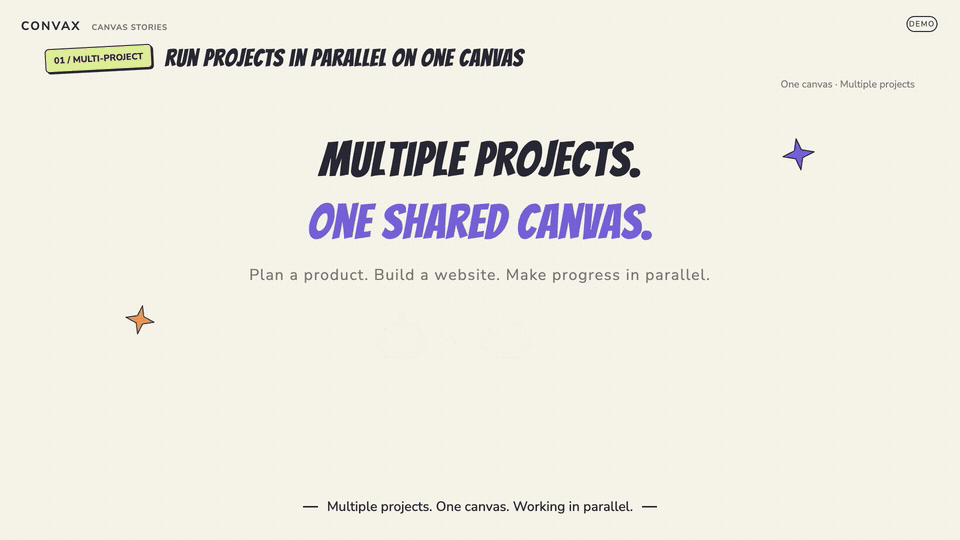
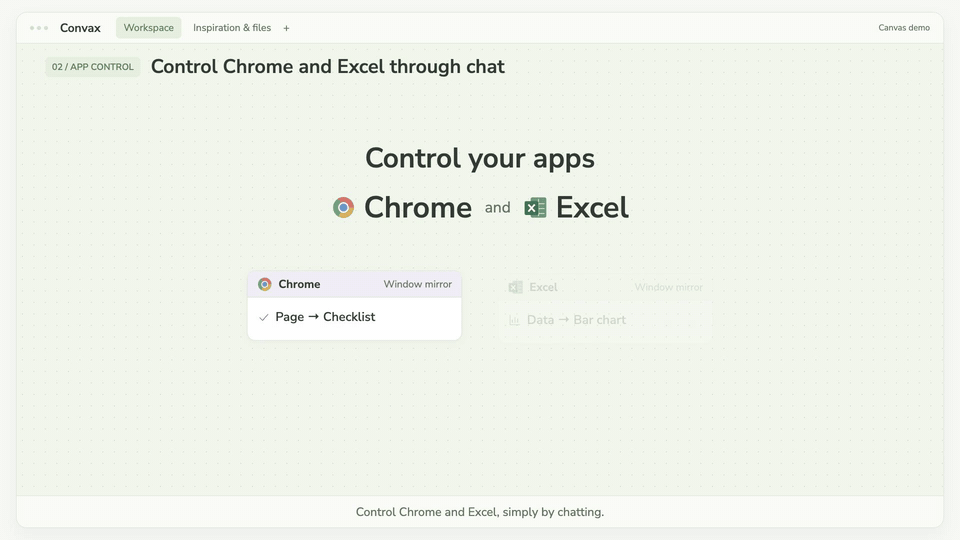

# Convax

English | [中文](README.zh.md)

An infinite canvas workspace for files, live window mirrors, and multi-threaded AI conversations, powered by [DeepSeek Harness](https://github.com/deepseek-ai/deepseek-harness).

Arrange your projects and conversations on a canvas, connect the resources a task needs, and work with AI in one workspace. Convax reuses DeepSeek Harness's conversation UI, composer, agent execution, and plugin system.

<a id="demos"></a>
## Demos

Watch the interface demos on the [Convax website](https://microvoid.io/convax/), or select a preview below to open the full MP4.

### Run multiple projects in parallel on one canvas

[](docs/assets/convax-demos/projects-en.mp4)

### Control Chrome and Excel through chat

[](docs/assets/convax-demos/apps-en.mp4)

<a id="features"></a>
## Features

| Feature | What you can do |
|---|---|
| Infinite canvas | Pan, zoom, select multiple cards, snap them into alignment, connect nodes, and undo or redo graph edits. Choose trackpad or mouse navigation. |
| Files and folders | Drag local resources into Desktop, browse folder cards, and expand previews for text, code, Markdown, images, PDF, spreadsheets, audio, and video. |
| Terminal and browser cards | Run interactive shells and browse pages directly on the canvas. Switching canvases or closing a canvas tab preserves them; deleting a card closes its resource. |
| AI conversations | Create Chat cards with multiple threads, fork conversations, and use the existing DSH composer, model controls, permissions, and tools. |
| Explicit references | Connect resources to a Chat to add removable references to its input. Sending uses the references in that draft; removing a reference keeps its canvas connection. |
| Window mirrors | Mirror a specific application window on macOS Desktop. Connect it to a Chat to capture a fresh screenshot when you send. |
| Multiple canvases | Switch and reorder browser-style tabs; search, rename, archive, restore, duplicate, or permanently delete saved canvases. |
| Default workspaces | Each canvas gets its own working directory. New Chats and terminals use it immediately. A terminal connected from a folder uses that folder; a file connection uses its parent directory. |

Window mirrors are read-only. Agent Computer Use is a separate, optional DSH capability that uses PTC mode and its existing application and macOS permissions.

<a id="repository-layout"></a>
## Repository layout

One root pnpm workspace and lockfile cover the repository. Turborepo coordinates builds, type checks, lint, and Convax tests, including the documentation site in `apps/docs/`. DSH source stays in `libs/dsh/`; the Convax Host and renderer live directly in `packages/`, keeping their package names and runtime entry points.

```text
apps/
  api/
  deploy-cloudflare/
  docs/
packages/
  api-contracts/
  plugin-host/
  plugin-renderer/
libs/
  dsh/
  DSH_UPGRADE.md
scripts/
  dsh.mjs
pnpm-workspace.yaml
pnpm-lock.yaml
turbo.json
```

[DSH upgrade notes](libs/DSH_UPGRADE.md) record the upstream commit, local adaptations, and upgrade checks. `libs/dsh/` is a source copy tracked in this repository, rather than a nested installation or Git submodule; install dependencies only at the repository root.

<a id="run"></a>
## Quick start

Convax is a developer preview. Run it from this repository with **Node.js 24.9.0 or newer** and **pnpm 11.28.5**, as declared in [package.json](package.json).

<a id="run-from-source"></a>
### Install and build

Clone this repository, then run these commands from its root:

```sh
pnpm install --frozen-lockfile
pnpm run build
```

<a id="development-commands"></a>
### Common commands

Run these commands from the repository root. Turbo tasks reuse DSH's build order, including Convax source, tests, and artifacts, and retain the Typert and client generation steps.

| Command | Purpose |
|---|---|
| `pnpm run build` | Build runtime, client, and documentation artifacts, then check DSH and documentation types. |
| `pnpm run test` | Run the Convax Host, renderer, and workspace regression tests. |
| `pnpm run test:workspace` | Check workspace discovery, Turbo tasks, and launcher data paths. |
| `pnpm run typecheck` | Check DSH, Convax, and documentation site types. |
| `pnpm run lint` | Run code and documentation authoring lint. |
| `pnpm run start:desktop` | Start Desktop with existing artifacts. |
| `pnpm run dev:desktop` | Rebuild and start Desktop. |
| `pnpm run dev:docs` | Start the Nimbus documentation development server. |
| `pnpm run build:docs` | Build the static documentation site in `apps/docs/dist/`. |
| `pnpm run check:docs` | Check documentation configuration, content, and types. |
| `pnpm run preview:docs` | Build and preview the static documentation site. |

<a id="desktop"></a>
### Desktop

Launch the development Desktop application using the built artifacts:

```sh
pnpm run start:desktop
```

Configure your API key in the Desktop welcome screen or settings. Desktop can also inherit `DEEPSEEK_API_KEY` from its launching process.

On a fresh installation, open **Plugins → Add plugin**, install `link:/absolute/path/to/convax/packages/plugin-renderer` using your checkout's actual absolute path, and choose **Enable now**. This activates the Convax Host and canvas renderer. Later launches retain the enabled bundle; the launcher itself only selects the Convax data directories.

To rebuild and launch after source changes:

```sh
pnpm run dev:desktop
```

Use Desktop for native file and folder drops and macOS window mirrors. See [Desktop development](libs/dsh/apps/desktop/README.md#develop) for platform setup.

<a id="web"></a>
### Web

Create a `.env` file in the repository root for Web conversations and real-API tests:

```dotenv
DEEPSEEK_API_KEY=your-deepseek-api-key
```

Start the Web profile with the Convax overlay:

```sh
pnpm dsh web --patch packages/plugin-renderer/cordis.patch.yml --no-open
```

Open the complete local access URL printed in the terminal; the server defaults to `http://127.0.0.1:3080`. The overlay enables both Convax plugins for this launch. Web runs against the Host filesystem; native window mirrors require macOS Desktop.

<a id="data-and-working-directories"></a>
## Data and working directories

- The Convax Desktop launcher stores its profiles, sessions, and canvas database under the repository's `.convax/` directory, with Electron preferences in `.convax/electron-user-data/`.
- New canvases create a working directory under `~/Documents/convax/canvas-<canvas-id>/` by default. New Chats share their canvas's directory; existing Chats retain their project paths. Renaming a canvas does not move its directory.
- Removing a resource card or deleting a canvas preserves original files. Canvas deletion stops and archives its conversations while retaining Session history.
- `.env` and `.convax/` are ignored by Git. Real-API tests use the API key from the root `.env`; credentials do not belong in source files or test fixtures.

<a id="development-and-documentation"></a>
## Development and documentation

- [API backend](docs/api-backend.md): cloud service architecture, AuthX integration boundaries, and local development.
- [Documentation site](apps/docs/README.md): bilingual guides and static builds with Nimbus. Run `pnpm run dev:docs` and open `http://localhost:4321/convax/docs/` for a local preview.
- [Convax packages](packages/README.md): Host persistence and the independently switchable renderer.
- [Canvas UI](packages/plugin-renderer/README.md): interactions, previews, Chat cards, and current limitations.
- [Plugin development](libs/dsh/docs/cookbook/convax-plugin-development.md): add custom canvas nodes and tools.
- [Development guide](libs/dsh/docs/development.md), [architecture](libs/dsh/docs/architecture.md), and [contributing](libs/dsh/CONTRIBUTING.md).
- [Agent instructions](AGENTS.md) and [safety notice](libs/dsh/SAFETY.md).

Convax is built on DeepSeek Harness and Cordis. Upstream runtime and plugin documentation remains under `libs/dsh/`.

<a id="license"></a>
## License

[MIT](LICENSE). Third-party dependencies and their licenses are listed in [THIRD_PARTY_NOTICES.md](libs/dsh/THIRD_PARTY_NOTICES.md).
