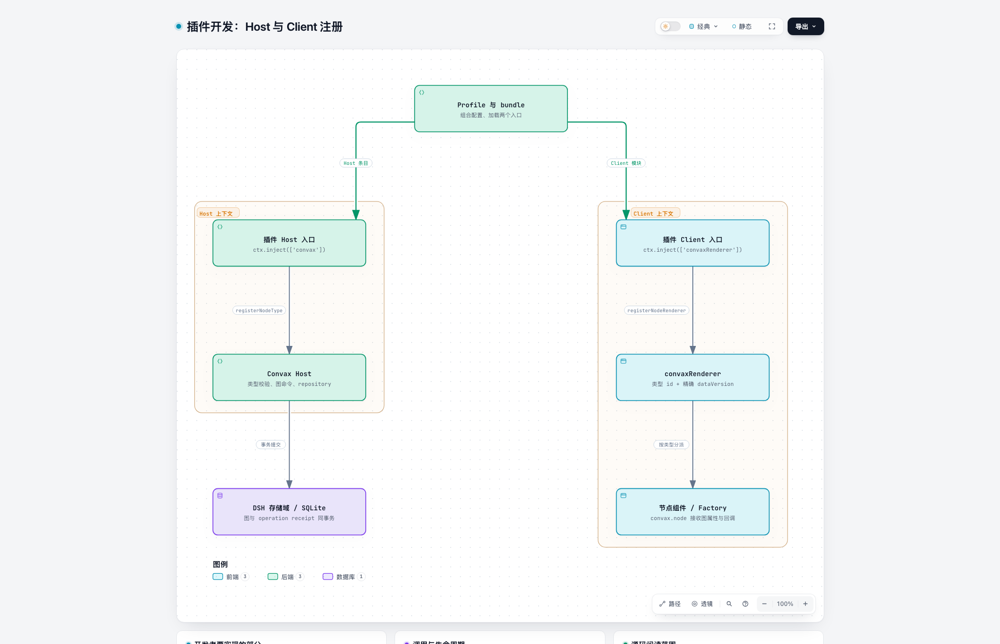
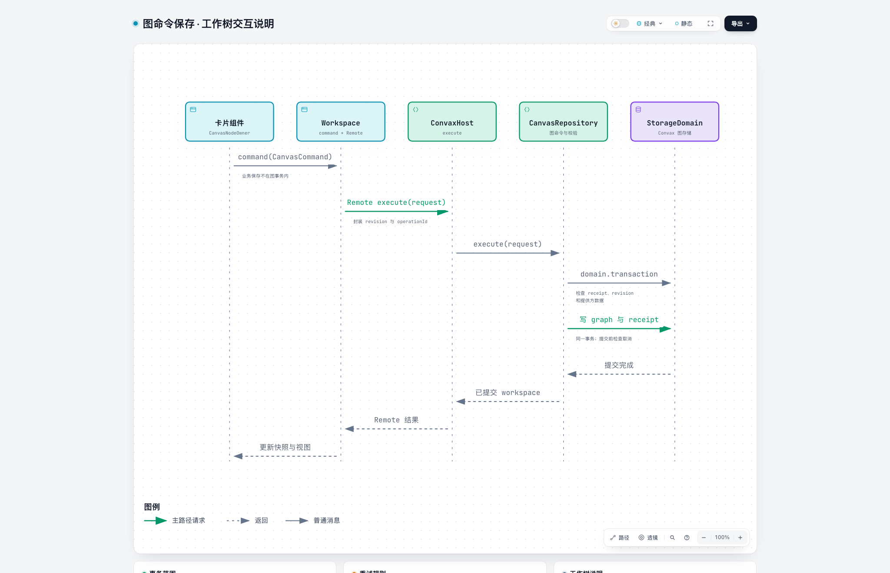
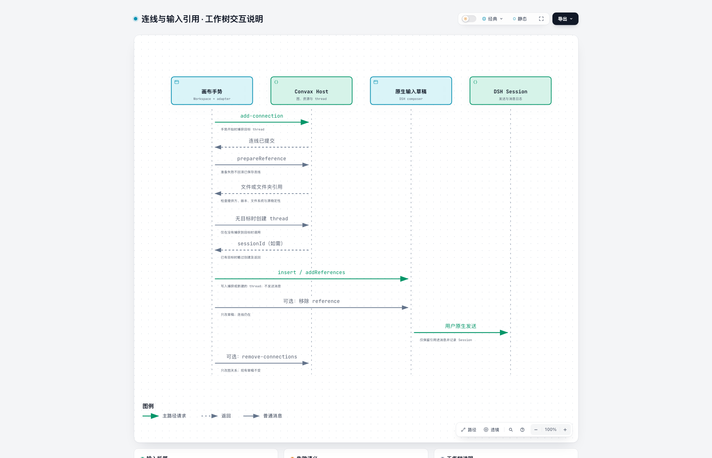

# Convax integration architecture

English | [中文](convax-plugin-contributing.zh.md)

## Summary

These three diagrams explain Host/Client registration, graph commands and composer references when connecting an existing DSH plugin to Convax. Follow the [integration guide](../cookbook/convax-plugin-development.md) for the APIs and the [counter example](../../../../packages/plugin-renderer/examples/counter/README.md) for a runnable starting point. Ordinary plugin development and Agent workflows remain in DSH documentation.

## Table of Contents

- [Understand runtime composition](#runtime-composition)
- [Follow UI actions and graph commands](#actions-and-commands)
- [Separate edges, references and Sessions](#references-and-sessions)
- [Handle lifecycle and payload versions](#lifecycle-and-versions)
- [Read and verify a contribution](#reading-and-verification)
- [Further Exploration](#further-exploration)
- [Dev Note](#dev-note)

-----

## Understand runtime composition

A profile selects bundles, and bundles contribute Cordis configuration rows. Host and Client run in separate contexts. Installing a dependency, selecting a bundle and successfully activating its rows are distinct outcomes.

The figures are generated with Archify. Their linked JSON files are editable diagram sources; update the source and generated image together when the interaction changes. The source-reading map below identifies the code that owns each behavior.

[Archify source](assets/convax-plugin/runtime.archify.json)

The profile shown composes both the feature and Convax. A portable feature does not activate the complete Convax bundle by itself. Its Host provider and Client card register only while their respective services are available; its native entry and business service can remain usable without them. The [product patch](../../../../packages/plugin-renderer/cordis.patch.yml) demonstrates independent Host and renderer rows and their storage composition.

A node component is registered for a stable type id and exact `dataVersion`. A Factory supplies stores, locale and child slots to components that need them. The canvas owns the node's graph props; the component owns its editor and display. Client metadata supports module loading, while Cordis service injection controls the registration lifetime. Read the [Client module reference](../../packages/client/modules/README.md) and [slot reference](../subsystems/slots.md) for those mechanisms.

## Follow UI actions and graph commands

An editor action calls the service that owns its data. Business content saves through the business service; node-only settings and geometry use Convax commands. A Client reaches Host methods through the generated Remote API, not a direct import of Host implementation code.

[Archify source](assets/convax-plugin/graph-command.archify.json)

The diagram shows a successful mutation. An identical retry uses its original operation identity and returns current committed state without repeating the mutation. Reusing that identity for different arguments is rejected; a revision conflict requires reading current state before submitting a revised intent. A failed business save and a failed graph save have different recovery owners; the graph transaction does not include the business save.

The node's supplied `command` callback accepts a `CanvasCommand`; the canvas owner supplies its request envelope. Direct Host or Remote callers supply that envelope themselves. The [command types](../../../../packages/plugin-host/src/types.ts), [repository](../../../../packages/plugin-host/src/repository.ts) and [developer examples](../cookbook/convax-plugin-development.md#connect-data-and-user-actions) define the detailed inputs and results.

## Separate edges, references and Sessions

An edge records a relationship, a reference belongs to an input draft, and sending uses DSH's conversation runtime. Their ownership is independent. A connection gesture can prepare a file or folder once for the thread selected when the gesture began; saved edges do not add hidden context to later messages.

[Archify source](assets/convax-plugin/connection-reference.archify.json)

Preparation checks the provider, node version and composed filesystem, and rejects cancellation or a changed source. Failure leaves the committed edge intact and reports reference insertion failure. Current preparation accepts file and folder references; a matching port name does not turn arbitrary note text into a supported input format. Connections do not start downstream execution.

DSH owns messages, native drafts and thread execution. Convax owns Chat bindings and graph records while embedding the existing conversation and composer. New model-visible input must remain reconstructable from Session history. The [draft adapter](../../../../packages/plugin-renderer/src/client/draft-references.ts), [gesture integration](../../../../packages/plugin-renderer/src/client/Workspace.tsx) and [Host reference method](../../../../packages/plugin-host/src/index.ts) show the actual separation.

## Handle lifecycle and payload versions

A contribution's registrations, subscriptions and asynchronous work follow their owning Cordis scope. Removing a provider is a lifecycle operation, not a request to delete its durable nodes. Business-data retention remains the business plugin's responsibility.

| Situation | Expected behavior | Owning mechanism |
|---|---|---|
| Provider or renderer disappears | Preserve payload, geometry and edges; show a usable placeholder | Independent Host and Client registrations |
| Provider is replaced during asynchronous work | Cancel and drain its work; reject stale results | Provider lifetime and registration identity checks |
| A supported payload upgrade succeeds | Validate transformed data, then commit while retaining migration recovery data | Pure adjacent migrations and Host transaction |
| A migration fails or its upgrade path is missing | Preserve the original payload and expose an incompatible node | Migration diagnostics and retry |
| Only Convax renderer is disabled | Restore native workspace while Convax Host can continue | Independent composition rows |

The npm package version and node payload version serve different purposes. Renderers accept an exact payload version; migrations change serialized data through supported adjacent steps. A plugin cannot repair incompatibility by discarding a user's node or silently replacing its business entity. Read the [provider registry](../../../../packages/plugin-host/src/registry.ts), [migration owner](../../../../packages/plugin-host/src/migrations.ts) and [renderer registry](../../../../packages/plugin-renderer/src/client/node-renderers.tsx) for lifecycle details.

## Read and verify a contribution

Read only the owners needed for the selected change. This map narrows the first source inspection; package READMEs and declarations remain authoritative for their detailed APIs.

| Question | First source |
|---|---|
| How does the product mount without replacing all native capabilities? | [Product composition](../../../../packages/plugin-renderer/cordis.patch.yml) and [Client apply](../../../../packages/plugin-renderer/src/client/index.ts) |
| What may a node store, and how is a command expressed? | [Client-safe types](../../../../packages/plugin-host/src/types.ts) |
| Where are provider validation and cancellation defined? | [Host registry](../../../../packages/plugin-host/src/registry.ts) |
| How does a node receive graph actions and injected UI dependencies? | [Node owner props](../../../../packages/plugin-renderer/src/client/props.ts) and [renderer registration](../../../../packages/plugin-renderer/src/client/node-renderers.tsx) |
| How do writes become committed snapshots? | [Transactional repository](../../../../packages/plugin-host/src/repository.ts) |
| Where do graph gestures become native references? | [Workspace](../../../../packages/plugin-renderer/src/client/Workspace.tsx) and [draft adapter](../../../../packages/plugin-renderer/src/client/draft-references.ts) |

The [counter README](../../../../packages/plugin-renderer/examples/counter/README.md) owns the example tests and installation checks. Refer to the [DSH development tutorial](../user/develop/basic/index.md) and [testing reference](../testing.md) for general plugin contribution, test selection and release workflows.

-----

## Further Exploration

- [Develop a Convax plugin](../cookbook/convax-plugin-development.md) — authoring against current APIs.
- [Counter example](../../../../packages/plugin-renderer/examples/counter/README.md) — registration, creation, saving and recovery.
- [DSH architecture](../architecture.md) — composition, Sessions and extension ownership.
- [Plugin extension proposal](../../.agents/notes/proposed/architecture/2026-10-30-convax-plugin-development.md) — SDK and shared contribution design.

## Dev Note

None.
