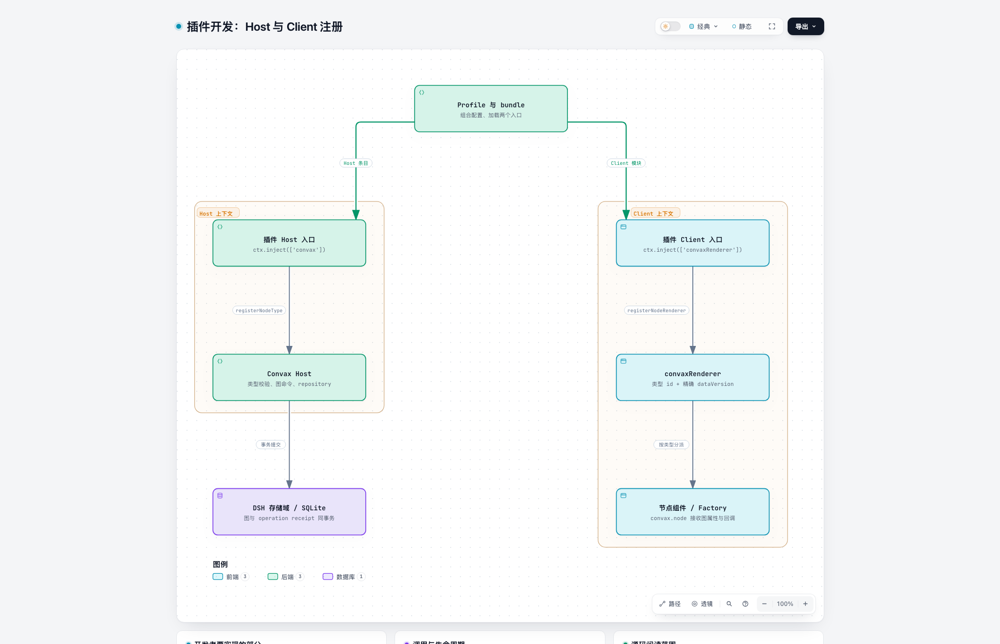
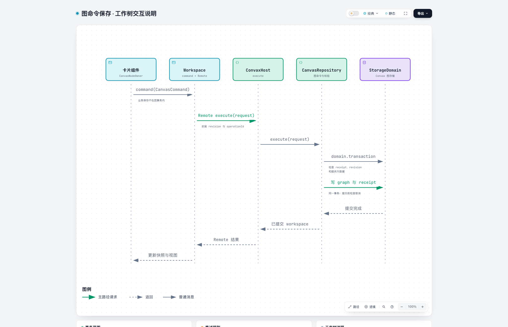
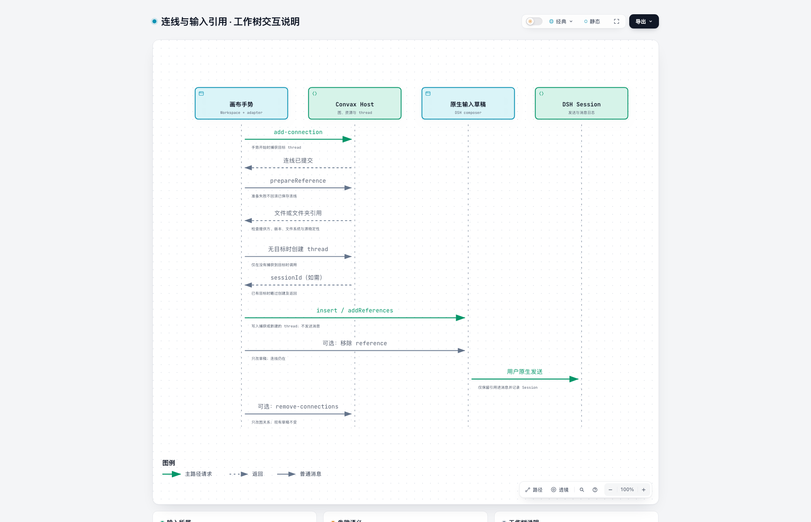

# Convax 接入架构

[English](convax-plugin-contributing.md) | 中文

## 概述

用三张图理解已有 DSH 插件接入 Convax 时的 Host/Client 注册、图命令与输入框引用。具体步骤见[接入指南](../cookbook/convax-plugin-development.zh.md)，从零运行见 [counter 示例](../../../../packages/plugin-renderer/examples/counter/README.zh.md)。通用插件开发与 Agent 工作流沿用 DSH 文档。

## 目录

- [理解运行时组合](#runtime-composition)
- [追踪 UI 操作与图命令](#actions-and-commands)
- [区分连线、引用和 Session](#references-and-sessions)
- [处理生命周期与数据版本](#lifecycle-and-versions)
- [阅读并验证贡献](#reading-and-verification)
- [进一步阅读](#further-exploration)
- [开发备注](#dev-note)

-----

## 理解运行时组合

Profile 选择 bundle，bundle 贡献 Cordis 配置条目。Host 与 Client 在独立上下文中运行。安装依赖、选择 bundle 和成功激活条目是不同结果。

图由 Archify 生成，链接的 JSON 文件是可编辑图源；交互变化时一起更新图源与生成图片。下方的源码阅读索引指出各项行为的代码所有者。

[Archify 图源](assets/convax-plugin/runtime.archify.json)

图中的 profile 同时组合业务功能与 Convax。可移植功能本身不会激活完整 Convax bundle；其 Host 提供方和 Client 卡片仅在各自服务可用时注册，原生入口和业务服务可以在缺少这些服务时继续使用。[产品 patch](../../../../packages/plugin-renderer/cordis.patch.yml)展示独立的 Host、renderer 条目及存储组合。

节点组件按稳定类型 id 和精确的 `dataVersion` 注册。需要 store、本地化和子插槽的组件通过 Factory 获得这些依赖。画布拥有节点的图属性，组件拥有其编辑器与展示。Client 元数据支持模块加载，Cordis 服务注入控制注册生命周期。机制细节见 [Client 模块参考](../../packages/client/modules/README.zh.md)与[插槽参考](../subsystems/slots.zh.md)。

## 追踪 UI 操作与图命令

编辑器操作调用拥有该数据的服务。业务正文通过业务服务保存，节点专用设置和几何信息使用 Convax 命令。Client 通过生成的 Remote API 调用 Host 方法，不直接导入 Host 实现代码。

[Archify 图源](assets/convax-plugin/graph-command.archify.json)

图中展示成功的修改。相同请求重试时使用原 operation id，返回当前已提交状态，不重复修改。用同一标识传入不同参数会被拒绝；revision 冲突时，先读取当前状态，再提交修订后的意图。业务保存失败与图保存失败的恢复所有者不同，图事务不包含业务保存。

节点收到的 `command` 回调接受 `CanvasCommand`，由画布所有者补齐请求封装。直接使用 Host 或 Remote 的调用方自行提供封装。[命令类型](../../../../packages/plugin-host/src/types.ts)、[仓库实现](../../../../packages/plugin-host/src/repository.ts)和[开发示例](../cookbook/convax-plugin-development.zh.md#connect-data-and-user-actions)定义具体输入与结果。

## 区分连线、引用和 Session

连线记录关系，引用属于输入草稿，发送使用 DSH 对话运行时，三者的所有权独立。连接手势可为手势开始时选中的 thread 准备一次文件或文件夹引用；已保存连线不会向后续消息加入隐藏上下文。

[Archify 图源](assets/convax-plugin/connection-reference.archify.json)

准备过程检查提供方、节点版本及已组合文件系统，拒绝取消或源资源变化。准备失败时保留已提交连线，并报告引用插入失败。当前准备支持文件和文件夹引用；端口名称匹配不会将任意笔记文本转换为支持的输入格式。连线不启动下游执行。

DSH 拥有消息、原生草稿与 thread 执行，Convax 拥有 Chat 绑定和图记录，并内嵌已有对话与输入框。新增模型可见输入必须能从 Session 历史重建。[草稿适配器](../../../../packages/plugin-renderer/src/client/draft-references.ts)、[手势集成](../../../../packages/plugin-renderer/src/client/Workspace.tsx)与 [Host 引用方法](../../../../packages/plugin-host/src/index.ts)展示实际职责分工。

## 处理生命周期与数据版本

贡献的注册、订阅和异步工作跟随所属 Cordis 作用域。移除提供方是生命周期操作，不是删除其持久节点的请求。业务数据保留方式仍归业务插件负责。

| 情况 | 预期行为 | 所属机制 |
|---|---|---|
| 提供方或 renderer 消失 | 保留载荷、几何信息和连线，展示可操作占位卡片 | 独立的 Host 与 Client 注册 |
| 异步工作期间替换提供方 | 取消并等待其工作结束，拒绝过期结果 | 提供方生命周期与注册身份检查 |
| 受支持的数据升级成功 | 校验转换结果，再提交，并保留迁移恢复数据 | 相邻纯迁移与 Host 事务 |
| 迁移失败或缺少迁移路径 | 保留原载荷，显示不兼容节点 | 迁移诊断与重试 |
| 仅停用 Convax renderer | 恢复原生工作区，Convax Host 可以继续工作 | 独立组合条目 |

npm 包版本与节点数据版本用途不同。Renderer 接受精确载荷版本，迁移通过受支持的相邻步骤修改序列化数据。插件不能通过丢弃用户节点或静默替换业务实体来解决不兼容。生命周期细节见[提供方注册表](../../../../packages/plugin-host/src/registry.ts)、[迁移所有者](../../../../packages/plugin-host/src/migrations.ts)和 [renderer 注册表](../../../../packages/plugin-renderer/src/client/node-renderers.tsx)。

## 阅读并验证贡献

只阅读所选改动涉及的所有者。以下索引缩小首次源码检查范围，具体 API 仍以包 README 和声明为准。

| 问题 | 优先阅读源码 |
|---|---|
| 产品如何挂载，同时保留原生能力？ | [产品组合](../../../../packages/plugin-renderer/cordis.patch.yml)与 [Client apply](../../../../packages/plugin-renderer/src/client/index.ts) |
| 节点能存什么，命令如何表达？ | [Client 安全类型](../../../../packages/plugin-host/src/types.ts) |
| 提供方校验与取消在哪里定义？ | [Host 注册表](../../../../packages/plugin-host/src/registry.ts) |
| 节点如何收到图操作和注入的 UI 依赖？ | [节点所有者 props](../../../../packages/plugin-renderer/src/client/props.ts)与 [renderer 注册](../../../../packages/plugin-renderer/src/client/node-renderers.tsx) |
| 写入如何成为已提交快照？ | [事务仓库](../../../../packages/plugin-host/src/repository.ts) |
| 图手势在哪里转为原生引用？ | [Workspace](../../../../packages/plugin-renderer/src/client/Workspace.tsx)与[草稿适配器](../../../../packages/plugin-renderer/src/client/draft-references.ts) |

示例的测试与安装验证步骤见 [counter README](../../../../packages/plugin-renderer/examples/counter/README.zh.md)。通用插件贡献规则、测试选择和发布流程分别参考 [DSH 开发教程](../user/develop/basic/index.zh.md)与[测试参考](../testing.zh.md)。

-----

## 进一步阅读

- [开发 Convax 插件](../cookbook/convax-plugin-development.zh.md)——使用当前 API 编写插件。
- [Counter 示例](../../../../packages/plugin-renderer/examples/counter/README.zh.md)——从注册到创建、保存与恢复。
- [DSH 架构](../architecture.zh.md)——组合、Session 与扩展所有权。
- [插件扩展方案](../../.agents/notes/proposed/architecture/2026-10-30-convax-plugin-development.zh.md)——SDK 与共享贡献设计。

## 开发备注

无。
